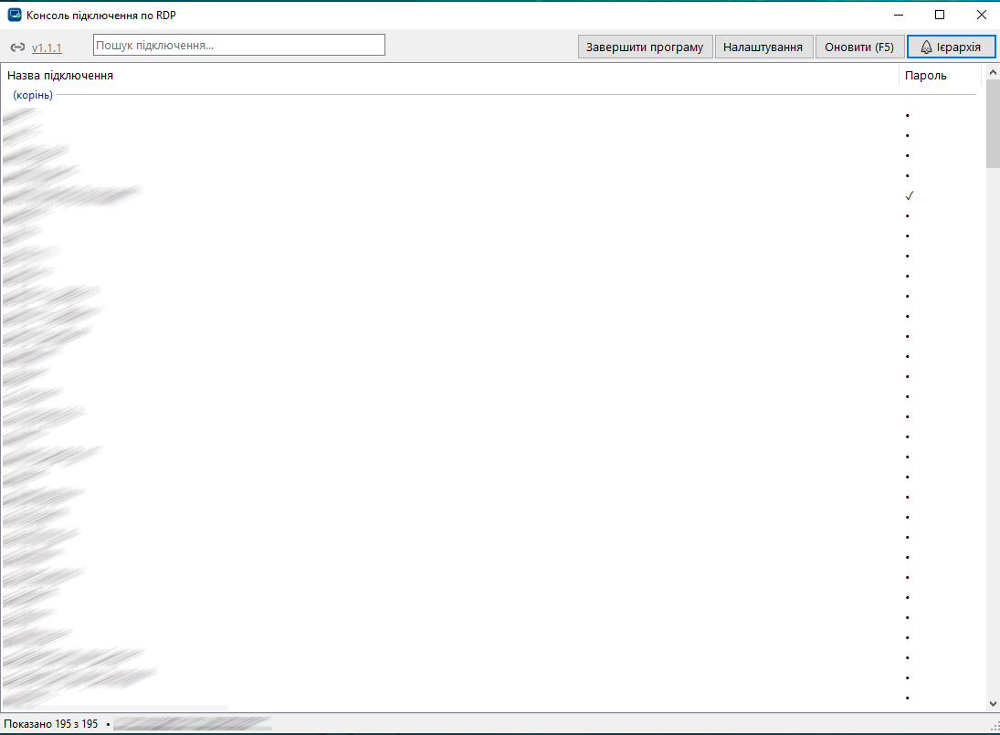
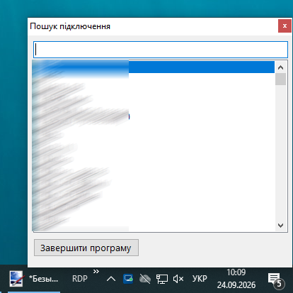

# RDP Console

**Швидкий пошук і запуск RDP-підключень для Windows.** Програма тримає всі
ваші `.rdp`-файли з однієї папки під рукою: дерево по клієнтах, миттєвий пошук
(навіть у неправильній розкладці), підключення в один клік з автоматичною
підстановкою пароля. Живе в треї, відкривається гарячою клавішею, а паролі й
налаштування можна синхронізувати між ПК через Google Drive у зашифрованому
вигляді. Підключення — через стандартний `mstsc.exe`; встановлення не потрібне,
один `.exe`.

Коротко про головне:

- 🔎 пошук за назвою підключення чи папки, у будь-якій розкладці (EN / УКР / РУС);
- 🌲 дерево папок як у провіднику або плаский список;
- 🗂 створення, копіювання, переміщення й видалення підключень прямо з меню ПКМ;
- 📌 закріплення частих підключень — завжди першими в дереві, списку й пошуку;
- 🔑 автопідстановка пароля: облікові дані Windows → пароль підключення → пароль папки → за замовчуванням;
- ☁️ спільні зашифровані налаштування для кількох ПК (наприклад, через Google Drive);
- 🖱 трей-віджет і глобальна гаряча клавіша (Ctrl+Alt+R) — пошук з будь-якого місця;
- 🛡 керування новим попередженням Windows "Невідоме віддалене підключення";
- 🚀 автозапуск із Windows у трей, автооновлення з GitHub, світла / темна / синя тема.

## Скриншоти

Головне вікно (ієрархічний перегляд) і вікно швидкого пошуку з трея:

<p>
  <br>
  
</p>

## Повний опис можливостей

### Перегляд і пошук

- **Папка з підключеннями** сканується рекурсивно: усі `*.rdp` разом із
  підпапками (наприклад, по клієнтах). F5 або "Оновити" — пересканувати.
- **Ієрархічний перегляд** (за замовчуванням) — дерево папок як у провіднику, з
  тими самими іконками папок і `.rdp`-файлів; на кожному рівні спершу папки, потім
  файли, за абеткою. Кнопка "☰ Список" / "🌲 Ієрархія" перемикає на плаский
  список, згрупований по папках; вибір запам'ятовується.
- **Миттєвий пошук** за назвою підключення або назвою папки; під час пошуку
  завжди показується плаский список збігів.
- **Пошук у неправильній розкладці** — запит, набраний не в тій розкладці
  (EN / УКР / РУС, ті самі клавіші), теж знаходить потрібне: `ыкм` чи `ікм` →
  `srv`, `cthdth` → `сервер`.
- **Закріплені підключення** — ПКМ → "📌 Закріпити" (можна кілька виділених
  одразу): у дереві з'являється група "📌 Закріплені" вгорі (у своїх папках
  підключення теж лишаються), у списку й результатах пошуку закріплені йдуть
  першими, у вікні з трея позначені 📌. "Відкріпити" — там само. Зберігається
  разом зі спільними налаштуваннями; при переміщенні файлу через програму
  закріплення переїжджає разом із ним.
- **"Не бере участь у пошуку"** — ПКМ на папці в дереві: файли цієї папки й
  усіх її підпапок не потрапляють у результати пошуку, але лишаються в дереві.
  Папка позначена "(без пошуку)".

### Підключення

- Подвійний клік / Enter / ПКМ → "Підключитися" — запуск через `mstsc.exe`;
  можна виділити кілька підключень у списку й відкрити всі разом.
- Перед підключенням створюється тимчасова копія `.rdp` (у `%TEMP%\RdpConsole\`),
  де примусово ввімкнено буфер обміну, принтери, смарт-карти й WebAuthn та
  дописано пароль. Оригінальний файл не змінюється, копія з паролем видаляється
  через ~20 секунд.
- **Комп'ютер / користувач** — ПКМ → "Комп'ютер / користувач..." показує й
  дозволяє змінити адресу комп'ютера та ім'я користувача, як у вікні `mstsc`.
  Зміни пишуться в сам `.rdp` (кодування й решта налаштувань без змін).
- **Керування підключеннями** (ПКМ, у головному вікні й у вікні з трея):
  - **"Нове підключення..."** — на папці, на файлі (у тій самій папці) або на
    порожньому місці (у кореневій папці): назва, комп'ютер, користувач і, за
    бажанням, пароль. Створюється звичайний `.rdp` у форматі `mstsc`.
  - **"Копіювати підключення..."** — копія в тій самій папці під новою назвою,
    разом зі збереженим паролем.
  - **"Перемістити в папку..."** — вибір папки (там же можна створити нову);
    пароль переїжджає разом із файлом. Можна виділити кілька підключень.
  - **"Видалити підключення"** (або клавіша Delete) — після підтвердження файл
    переміщується в Кошик, збережений пароль видаляється.
  Розгорнуті папки й виділення в дереві після цих дій зберігаються.
- Інші пункти ПКМ: "Показати у провіднику", "Копіювати шлях", "Редагувати файл
  (Блокнот)".

### Паролі

Пароль підставляється в `mstsc` автоматично — у тому самому форматі
(`password 51:b:...`), яким `mstsc` сам зберігає облікові дані, тож вікно
введення пароля зазвичай не з'являється. У буфер обміну паролі не копіюються.

Звідки береться пароль (у порядку пріоритету):

1. **Облікові дані Windows** для сервера (Диспетчер облікових даних →
   Облікові дані Windows → `TERMSRV/<адреса>`, наприклад після "Запам'ятати
   мене" в `mstsc`) — програма нічого не підставляє, `mstsc` бере їх сам.
   Застарілий запис можна прибрати: ПКМ → "Видалити облікові дані Windows".
2. **Пароль підключення** — ПКМ → "Зберегти пароль підключення...".
3. **Пароль папки** — ПКМ на папці в дереві (або в меню файлу) → "Зберегти
   пароль папки..."; діє на всі файли в папці й підпапках, найближча папка має
   пріоритет. Папка з паролем позначена 🔑.
4. **За замовчуванням** (Налаштування) — список пар "користувач → пароль":
   підставляється, коли користувач у `.rdp` збігається (`admin` підходить і до
   `SERVER\admin`); запис із порожнім користувачем — для будь-якого.

Колонка "Пароль" (і мітка в дереві) показує, звідки буде взято пароль:
**W** — облікові дані Windows, **✓** — пароль підключення, **📁** — пароль
папки, **•** — за замовчуванням, порожньо — пароля немає. Підказка при
наведенні показує точне джерело. Мітки й пункти керування паролями є і в
головному вікні, і у вікні швидкого пошуку з трея.

Паролі підключень прив'язані до шляху файлу відносно кореневої папки: якщо
файл перейменувати чи перенести, пароль автоматично переходить на файл з тією
самою адресою й користувачем.

**Запис в облікові дані Windows** (Налаштування, опційно) — при підключенні
пароль із програми зберігається в Диспетчері облікових даних
(`TERMSRV/<адреса>`) замість тимчасового файлу; далі підключення позначене W.
Потрібен користувач у `.rdp`.

### Налаштування та синхронізація між ПК

- **Папка налаштувань** (Налаштування → "Папка для збереження налаштувань і
  паролів") — наприклад, папка на Google Drive: тоді паролі, облікові дані за
  замовчуванням, тема, гаряча клавіша тощо доступні на всіх ваших ПК.
  Зберігаються у файлі `RdpConsole.dat`, зашифрованому AES-256 + HMAC-SHA256.
- Окремо для кожного ПК (`%AppData%\RdpConsole\local.json`, без паролів) —
  папка з `.rdp`, розмір вікна й шлях до папки налаштувань.
- Якщо вибрати папку, де вже є `RdpConsole.dat` (з іншого ПК), програма
  запропонує завантажити його або перезаписати поточними налаштуваннями.
- Зміни, зроблені на іншому ПК, підхоплюються автоматично (при відкритті вікна,
  F5); перед кожним записом файл перечитується, щоб не затерти чужі зміни.
  Пошкоджений чи ще не синхронізований файл програма не перезаписує.

### Трей, гаряча клавіша, автозапуск

- **Іконка в треї** — програма працює у фоні; закриття вікна чи згортання
  ховає його в трей. ЛКМ по іконці — головне вікно, ПКМ — **вікно швидкого
  пошуку** біля курсора: майже на всю висоту екрана, дерево / список, Enter —
  підключитися, Esc — закрити, ПКМ — ті самі дії, що й у головному вікні.
- **Глобальна гаряча клавіша** (за замовчуванням Ctrl+Alt+R) відкриває вікно
  швидкого пошуку з будь-якого місця Windows. Комбінацію можна змінити або
  вимкнути в Налаштуваннях.
- **Автозапуск** (Налаштування → "Запускати разом із Windows") — програма
  стартує одразу згорнутою в трей. Прав адміністратора не потребує.
- **Один екземпляр** — повторний запуск не створює другу копію, а показує вікно
  вже запущеної.
- **"Завершити програму"** — кнопка в головному вікні та у вікні швидкого
  пошуку; лише вона дійсно закриває програму.

### Попередження Windows "Невідоме віддалене підключення"

Квітневе оновлення Windows 2026 року
([CVE-2026-26151](https://learn.microsoft.com/en-us/windows-server/remote/remote-desktop-services/remotepc/understanding-security-warnings))
додало до `mstsc` вікно, яке з'являється при кожному відкритті непідписаного
`.rdp`, і в ньому вимкнені всі перенаправлення (буфер обміну, смарт-карти
тощо). У Налаштуваннях видно поточний стан і кнопка **"Прописати"** — вона
записує документований Microsoft параметр `RedirectionWarningDialogVersion = 1`
у `HKLM\Software\Policies\Microsoft\Windows NT\Terminal Services\Client`
(повертає попередню поведінку). Потрібне підтвердження UAC, діє на всіх
користувачів ПК; кнопка "Прибрати" повертає як було. Microsoft попереджає, що
підтримку параметра можуть прибрати в майбутніх оновленнях.

### Оформлення та оновлення

- **Тема** — світла, темна або синя; застосовується одразу до всіх вікон.
- **Прозорий фон Mica** — на Windows 11 (22H2+) розмитий фон верхньої панелі
  й статус-рядка.
- **Оновлення з GitHub** — зліва вгорі іконка репозиторію й номер версії.
  Тиха перевірка при кожному запуску: якщо є новіша версія, номер підсвічується
  помаранчевим (`v1.9.0 ↑`). Клік по номеру — завантажити `.exe` з останнього
  релізу й перезапуститися.

## Встановлення / запуск

Встановлення не потрібне — один файл `RdpConsole.exe` без залежностей, крім
.NET Framework 4 (вбудований у Windows 10/11 та Windows Server 2012 R2+).

При першому запуску програма запитає папку з файлами `.rdp`
(наприклад, `D:\GoogleDrive\_WORK\RDP`).

Оновлення з версій до 1.6: старий `%AppData%\RdpConsole\settings.json`
переноситься в новий формат автоматично (пароль за замовчуванням стає записом
"для будь-якого користувача"), а сам файл перейменовується на `settings.json.bak`.

## Збірка з вихідного коду

Ідея та стиль збірки — за прикладом
[ShadowSessionTool](https://github.com/Pro100NeFarT/ShadowSessionTool): один
файл `.cs`, який компілює вбудований у Windows `csc.exe` (з .NET Framework), без
.NET SDK чи Visual Studio.

```powershell
.\build.ps1
```

Скрипт викликає вбудований компілятор:

```powershell
$csc = "$env:WINDIR\Microsoft.NET\Framework64\v4.0.30319\csc.exe"
& $csc /target:winexe /platform:anycpu /codepage:65001 `
    /out:RdpConsole.exe `
    /win32manifest:app.manifest `
    /win32icon:RdpConsole.ico `
    /reference:System.dll,System.Core.dll,System.Windows.Forms.dll,System.Drawing.dll,System.Runtime.Serialization.dll,System.Security.dll,Microsoft.VisualBasic.dll `
    RdpConsole.cs
```

Іконка `RdpConsole.ico` генерується скриптом `GenerateIcon.ps1`.

## Нотатки щодо безпеки

- Права адміністратора не потрібні (`asInvoker` у `app.manifest`) — окрім
  запису параметра попередження RDP (запит UAC лише на цю дію).
- `RdpConsole.dat` зашифровано ключем, вбудованим у програму: файл можна
  переносити між ПК (наприклад, через Google Drive), але він захищає від
  стороннього погляду, а не від того, хто має і файл, і вихідний код програми.
  Не викладайте `RdpConsole.dat` у публічний доступ.
- Паролі, які `mstsc` зберіг у Windows ("Запам'ятати мене"), Windows не віддає
  стороннім програмам — тому RDP Console їх не читає й не переносить, а лише
  враховує як джерело з найвищим пріоритетом.
